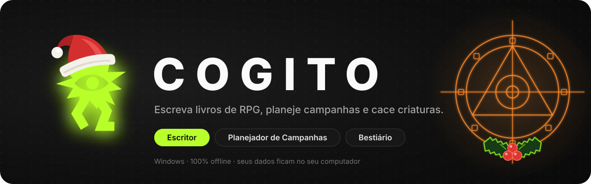
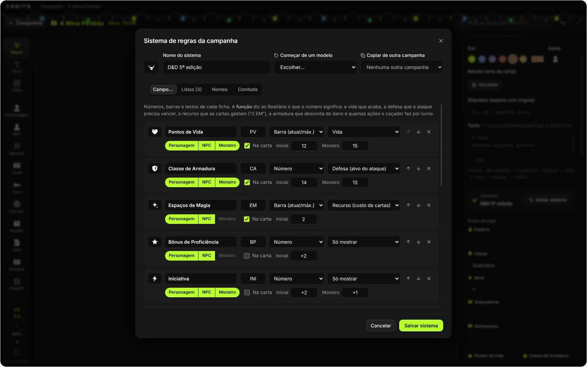
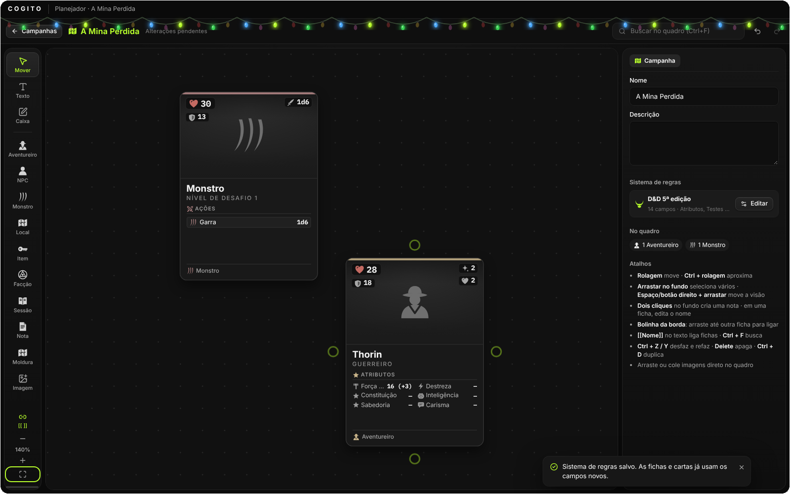
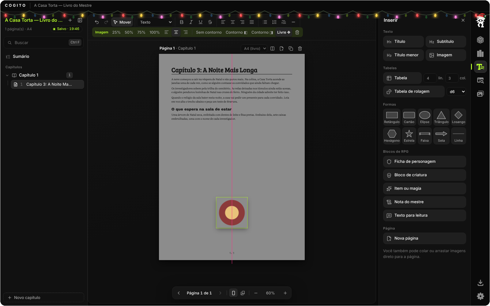
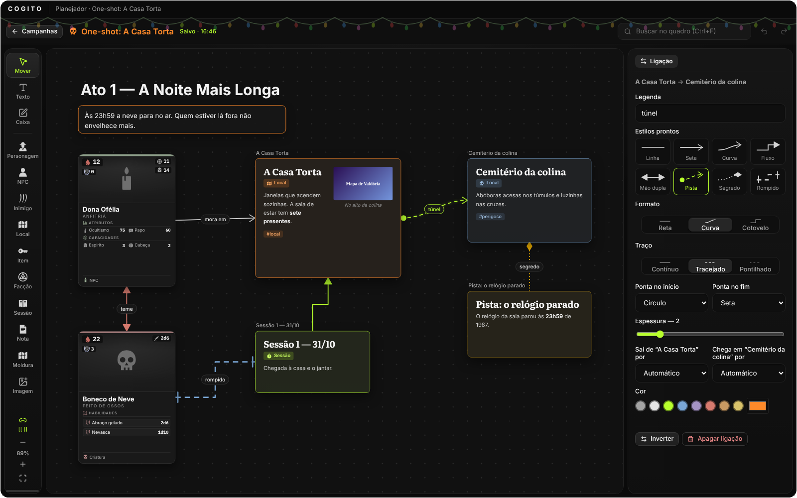
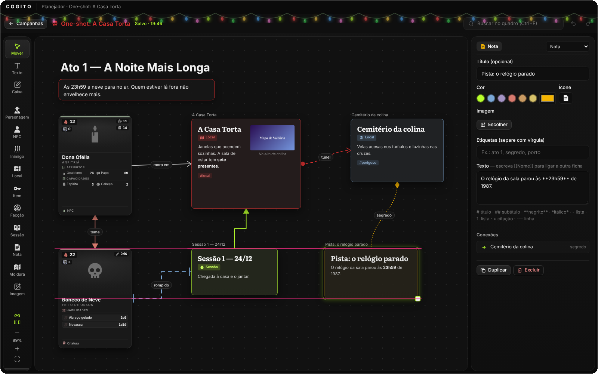
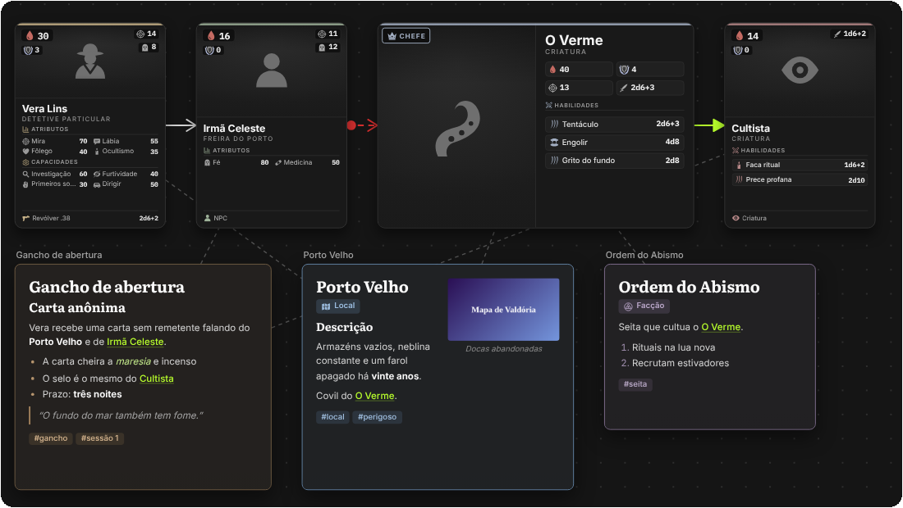
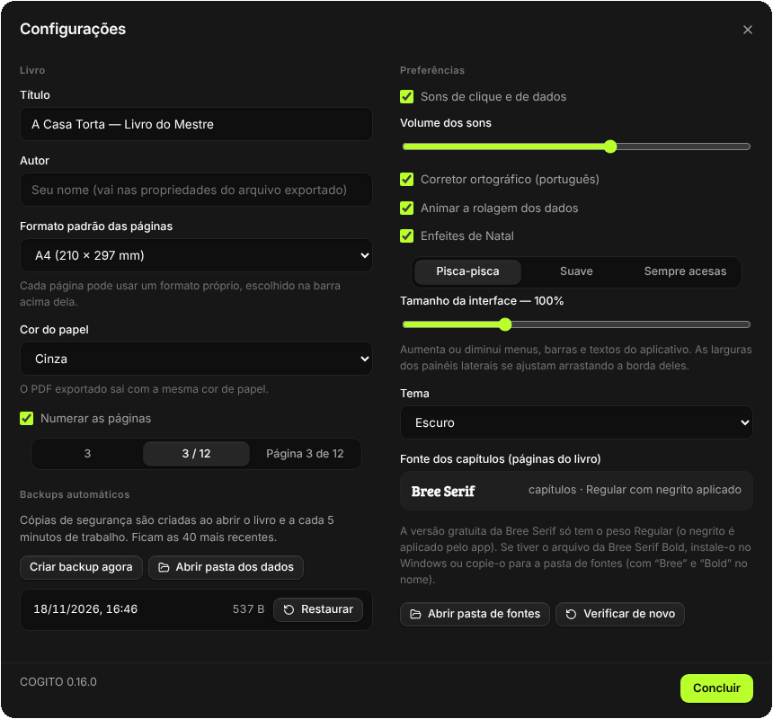
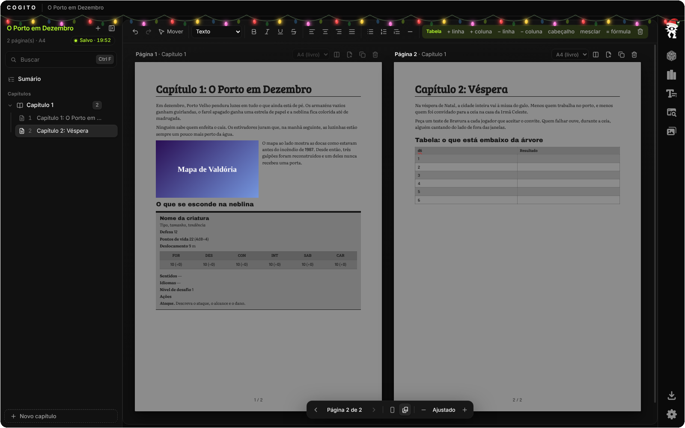
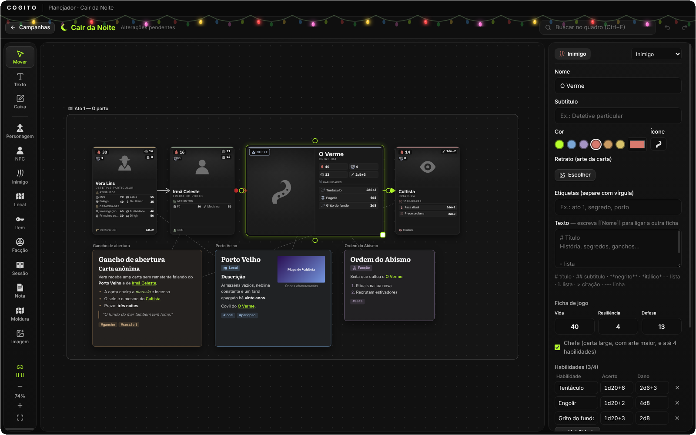

<p align="center">
  <a href="#o-que-chegou-na-016"></a>
</p>

<p align="center">
  <a href="../../releases/latest/download/COGITO-Instalador.exe"></a>
  <br>
  <a href="../../releases/latest/download/COGITO-windows-x64.zip"></a>
</p>

<p align="center">
  <sub>Windows 10 e 11 · gratuito · funciona sem internet · em português</sub>
  <br>
  <a href="CHANGELOG.md">Novidades</a> &nbsp;·&nbsp;
  <a href="docs/MANUAL.md">Manual</a> &nbsp;·&nbsp;
  <a href="../../releases">Todas as versões</a> &nbsp;·&nbsp;
  <a href="../../issues/new?template=bug.yml">Relatar um problema</a> &nbsp;·&nbsp;
  <a href="../../issues/new?template=ideia.yml">Sugerir uma ideia</a> &nbsp;·&nbsp;
  <a href="../../discussions">Conversar</a>
</p>

<br>

O **COGITO** é um aplicativo para quem escreve e mestra RPG de mesa. Num lugar só, você escreve e diagrama o livro,
monta a campanha num quadro infinito e testa os personagens contra as criaturas que criou, em combate por turnos.
Não tem conta, não tem assinatura e não usa internet: tudo fica numa pasta do seu computador.

A versão 0.17 abre o COGITO para **qualquer sistema de RPG**, e a 0.16 trouxe a edição de Natal, com luzinhas no alto
da janela e um gorro no logo. As novidades das duas vêm logo abaixo.

<p align="center"></p>

## Novo na 0.17: qualquer sistema

Cada campanha agora tem o seu **sistema de regras**, e tudo nele se edita: o nome, a sigla e o ícone de cada número,
barra e texto da ficha, as listas (Atributos, Perícias, Características…), os nomes dos tipos de ficha e de carta e
as rolagens de acerto. Para começar, há modelos de **D&D 5ª edição**, **Call of Cthulhu**,
**Ordem Paranormal**, **Daggerheart**, **Pathfinder 2ª edição**, do sistema **COGITO** e um **em branco**. Trocar de
sistema não apaga nenhum valor já preenchido.



Cada campo pode ter uma função na ficha: vida, defesa, recurso que as cartas gastam, armadura ou ações por turno.
O acerto pode ser uma rolagem contra a defesa, uma porcentagem com 1d100 (como no Call of Cthulhu) ou automático.


<sub>Cartas no D&D, com um campo criado na hora (Corrupção).</sub>

<p align="center"></p>

## O que chegou na 0.16

<table>
  <tr>
    <td width="50%" valign="top">
      <b><a href="#mover-no-escritor">Mover no Escritor</a></b><br>
      <sub>Imagens e formas em qualquer ponto da página, com guias de alinhamento.</sub>
    </td>
    <td width="50%" valign="top">
      <b><a href="#setas-e-linhas-no-quadro">Setas e linhas no quadro</a></b><br>
      <sub>Saem dos quatro lados da ficha, em reta, curva ou cotovelo, com seis tipos de ponta.</sub>
    </td>
  </tr>
  <tr>
    <td valign="top">
      <b><a href="#texto-solto-caixas-e-guias">Texto solto, caixas e guias</a></b><br>
      <sub>Títulos e anotações direto no quadro, alinhados com Shift.</sub>
    </td>
    <td valign="top">
      <b><a href="#cartas-novas-no-quadro">Cartas novas no quadro</a></b><br>
      <sub>Tons sóbrios, ícones em cada número e o chefe ocupando duas cartas.</sub>
    </td>
  </tr>
  <tr>
    <td valign="top">
      <b><a href="#contador-de-páginas">Contador de páginas</a></b><br>
      <sub>“3 / 12” no pé da página, também no PDF e no Word.</sub>
    </td>
    <td valign="top">
      <b><a href="#enfeites-de-natal">Enfeites de Natal</a></b><br>
      <sub>Pisca-pisca com oito efeitos e gorro no logo. Dá para desligar.</sub>
    </td>
  </tr>
</table>

### Mover no Escritor

Ligue a ferramenta **Mover** na barra (ou `Ctrl+M`) e arraste uma imagem ou forma para onde quiser: ela sai do fluxo
do texto e fica solta na página, como num programa de diagramação. Segurando **Shift**, ela encaixa no centro e nas
bordas da página, nas margens e nos outros elementos soltos, e uma linha mostra o alinhamento. `Esc` desliga a
ferramenta. No PDF e no Word, o elemento sai exatamente no mesmo lugar.



### Setas e linhas no quadro

Passe o mouse sobre uma ficha e puxe uma ligação de qualquer um dos quatro lados. Clicando nela, o painel da direita
oferece o formato (**reta**, **curva** ou **cotovelo**), o traço (**contínuo**, **tracejado** ou **pontilhado**), a
ponta de cada lado (seta, triângulo, círculo, losango ou barra), a espessura, a cor e por qual lado ela sai e chega.
Oito estilos prontos resolvem os casos comuns, como *Pista*, *Segredo* e *Rompido*, e o último estilo usado vale para
as próximas ligações.



### Texto solto, caixas e guias

A barra do quadro ganhou três ferramentas: **Mover** (`V`), **Texto** (`T`), para títulos e rótulos soltos, e
**Caixa de texto** (`B`), para lembretes com borda. Tamanho, alinhamento, negrito, itálico e cor ficam no painel.
Arrastando qualquer ficha com **Shift**, ela encaixa nas bordas e no centro das vizinhas. As barras laterais agora
mudam de largura: é só arrastar a borda.



### Cartas novas no quadro

As cartas de personagem, NPC e criatura do Planejador ficaram mais discretas: fundo cinza, um filete de cor por tipo
e um ícone em cada número, atributo e capacidade. O **chefe** virou uma carta larga, do tamanho de duas, com a arte
maior. Campanhas antigas se ajustam sozinhas, e o que estava ao lado do chefe abre espaço para ele.



### Contador de páginas

O número da página fica no centro, embaixo, no formato “3 / 12”. Nas configurações do livro dá para trocar por só o
número ou por “Página 3 de 12”. O formato escolhido também vale para o PDF e para o Word.

### Enfeites de Natal

Luzinhas no alto da janela e um gorro no logo. As luzes seguem um programa como o dos pisca-piscas de verdade:
sequência, alternado, todas juntas, ondas, acende devagar, cintilante, combinação e acesas, e então recomeça. Em
**Configurações** você troca para um cintilar suave, deixa sempre acesas ou desliga os enfeites. Com a opção de reduzir
movimento do Windows ligada, elas ficam paradas.

<p align="center"></p>

<p align="center"></p>

## As três áreas

### Escritor

Livros diagramados página a página, com capítulos, sumário automático, tabelas com fórmulas, tabelas de rolagem,
formas, imagens com contorno de texto, fichas e blocos de criatura. Veja uma página ou duas lado a lado, e exporte em
PDF e DOCX com as fontes embutidas.



### Planejador de Campanhas

Um quadro infinito por campanha. Personagens, NPCs e criaturas viram cartas com a ficha de jogo; locais, facções,
sessões e notas viram cartões com Markdown e links <code>[[assim]]</code> entre eles. O painel da direita edita o que
estiver selecionado.



O passo a passo de cada recurso está no **[Manual](docs/MANUAL.md)**.

## Instalar

1. Clique em **Baixar para Windows** no alto desta página. Se preferir não instalar nada, use a **versão portátil**:
   extraia o `.zip` e abra o `COGITO.exe`.
2. Na primeira vez, o Windows pode avisar que **“protegeu o computador”**, porque o aplicativo ainda não tem assinatura
   digital. Clique em **Mais informações** e depois em **Executar assim mesmo**.

Livros e campanhas ficam em `Documentos\COGITO`. Para guardar um backup ou levar para outro computador, copie essa
pasta. O aplicativo também faz cópias automáticas enquanto você trabalha.

## Atalhos novos

| Onde | Atalho | O que faz |
| --- | --- | --- |
| Escritor | `Ctrl+M` | Liga e desliga a ferramenta Mover |
| Escritor e quadro | `Shift` ao arrastar | Encaixa nas guias de alinhamento |
| Escritor | `Ctrl+Home` / `Ctrl+End` | Vai ao começo ou ao fim do texto |
| Quadro | `V` · `T` · `B` | Mover · Texto · Caixa de texto |
| Quadro | Setas do teclado | Empurram a seleção (com `Shift`, de 10 em 10) |
| Os dois | `Esc` | Volta à ferramenta normal |

## Próximos passos

- **COGITO 1.0**: o app deixa de ser só de RPG e vira uma ferramenta geral, com quatro pilares: **Escrita**,
  **Quadro e Memórias**, **Finanças** e **Editor de imagens**. O Bestiário sai; o RPG passa a ser uma extensão à parte.

Tem uma ideia? [Sugira aqui](../../issues/new?template=ideia.yml) ou comente nas [Discussões](../../discussions).

## Participar

| Para | Use |
| --- | --- |
| Avisar que algo deu errado | [Relatar um problema](../../issues/new?template=bug.yml) |
| Pedir um recurso ou melhoria | [Sugerir uma ideia](../../issues/new?template=ideia.yml) |
| Tirar dúvidas, mostrar o que criou, conversar | [Discussões](../../discussions) |
| Saber de cada versão nova | **Watch › Custom › Releases**, no alto da página, ou o [histórico de novidades](CHANGELOG.md) |

Antes de relatar um problema, veja se ele já está na [lista de problemas abertos](../../issues). O
[guia de participação](CONTRIBUTING.md) explica o resto.

## Para desenvolvedores

```bash
npm install
npm run dev        # abre o app em modo de desenvolvimento
npm run lint       # linter
npm test           # testes de unidade
npm run test:e2e   # testes de interface (depois do build)
npm run dist       # instalador e .zip para Windows
```

Feito com Electron, React, TypeScript e Vite; editor TipTap/ProseMirror, leitor pdf.js e exportação DOCX via `docx`.
Cada versão é compilada e publicada pelo GitHub Actions quando a versão do `package.json` muda no `main`.

## Licença

© 2026 o autor do COGITO. **Todos os direitos reservados.** O código está aberto para consulta e para acompanhar o
desenvolvimento; o aplicativo pode ser baixado e usado de graça. Detalhes em [LICENSE](LICENSE).
