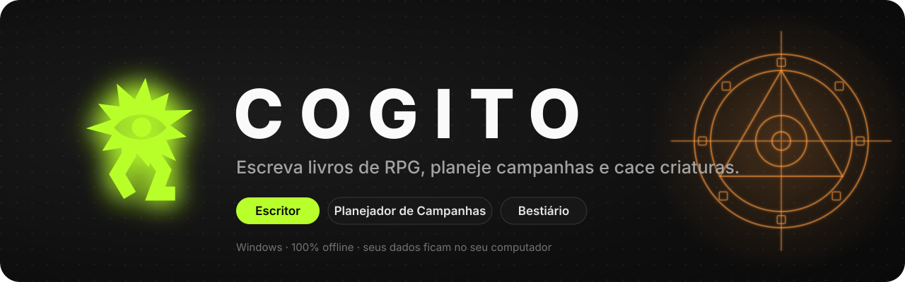
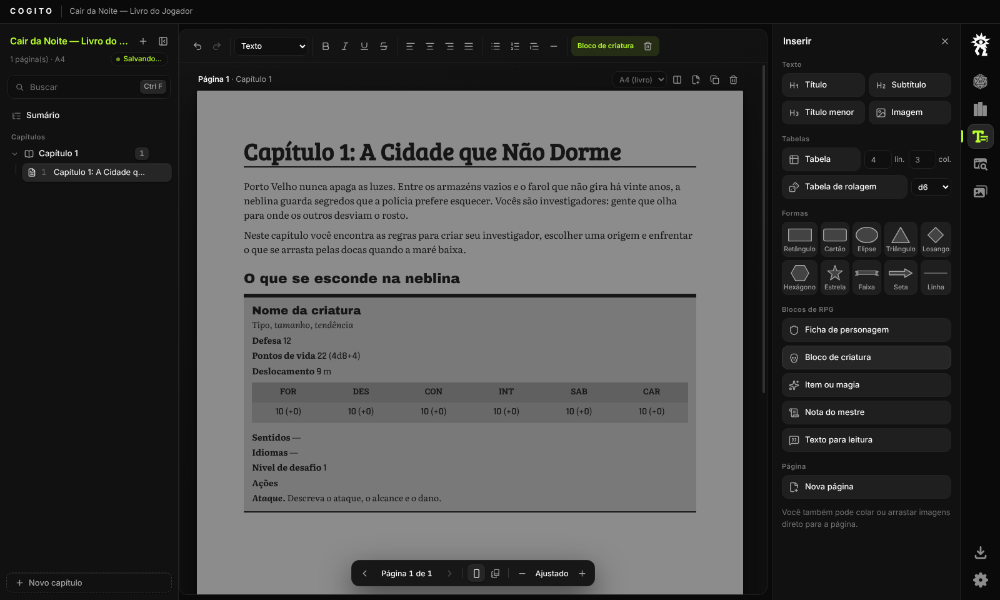
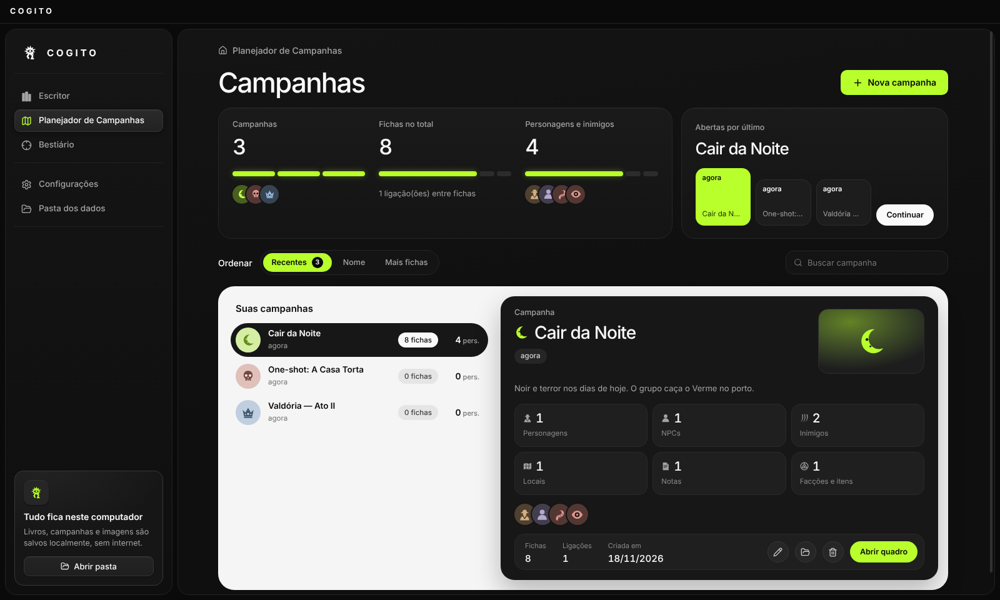
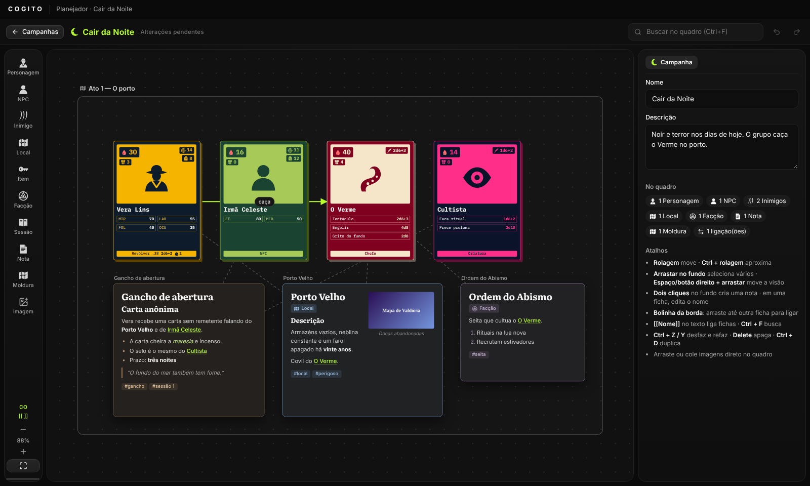
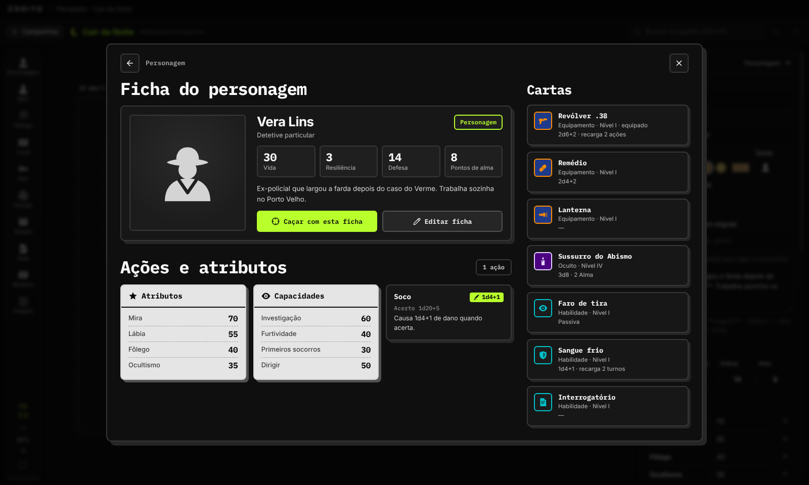
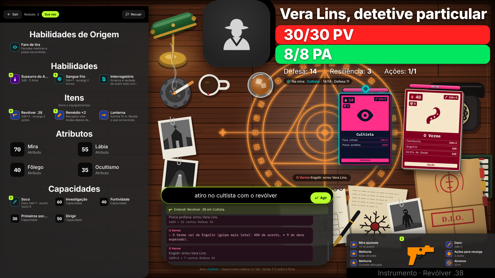
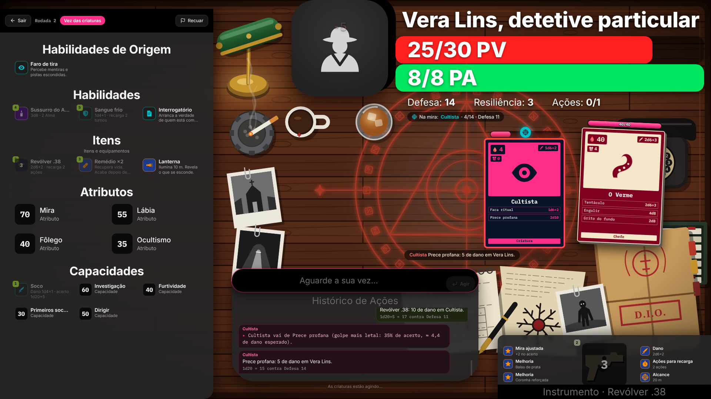

<p align="center">
  
</p>

<p align="center">
  <a href="../../releases/latest"></a>
  
  
  
  <a href="../../releases"></a>
</p>

<p align="center">
  <a href="../../releases/latest"><b>⬇️ Baixar</b></a>
  &nbsp;·&nbsp;
  <a href="CHANGELOG.md"><b>📰 Novidades</b></a>
  &nbsp;·&nbsp;
  <a href="../../issues/new?template=bug.yml"><b>🐞 Reportar um bug</b></a>
  &nbsp;·&nbsp;
  <a href="../../issues/new?template=ideia.yml"><b>💡 Sugerir uma ideia</b></a>
  &nbsp;·&nbsp;
  <a href="../../discussions"><b>💬 Conversar</b></a>
  &nbsp;·&nbsp;
  <a href="docs/MANUAL.md"><b>📖 Manual</b></a>
</p>

---

**COGITO** é um aplicativo para Windows feito para quem escreve e mestra RPG de mesa. Ele reúne três áreas num lugar só:
um **editor de livros** com diagramação pronta para impressão, um **quadro livre** para planejar campanhas e um
**Bestiário** onde você testa seus personagens contra as criaturas que criou. Não tem conta, não tem assinatura e não
usa internet: tudo fica guardado no seu computador.

<table>
  <tr>
    <td width="33%" valign="top">
      <h3>✍️ Escritor</h3>
      Escreva e diagrame livros de RPG página a página, com capítulos, sumário automático, tabelas com fórmulas,
      formas, fichas e blocos de criatura. Exporte em PDF e DOCX.
    </td>
    <td width="33%" valign="top">
      <h3>🗺️ Planejador de Campanhas</h3>
      Um quadro infinito por campanha, no espírito do Miro e do Obsidian: personagens, NPCs, inimigos, locais, notas
      em Markdown e ligações <code>[[assim]]</code> entre tudo.
    </td>
    <td width="33%" valign="top">
      <h3>🎯 Bestiário</h3>
      Combate em turnos sobre uma mesa de investigador. Escreva o que seu personagem faz e o jogo interpreta com as
      armas, itens e habilidades da ficha. As criaturas sempre buscam o golpe mais letal.
    </td>
  </tr>
</table>

## ⬇️ Baixar e instalar

1. Abra a página da **[última versão](../../releases/latest)**.
2. Baixe um dos arquivos:
   - **`COGITO-Instalador-<versão>.exe`**: instala com atalho no menu Iniciar e na área de trabalho;
   - **`COGITO-<versão>-windows-x64.zip`**: versão portátil, é só extrair e abrir o `COGITO.exe`.
3. Na primeira vez, o Windows pode mostrar **"O Windows protegeu o computador"**, porque o aplicativo ainda não tem
   assinatura digital. Clique em **Mais informações › Executar assim mesmo**.

Seus livros e campanhas ficam em `Documentos\COGITO`. Para fazer um backup ou levar para outro computador, copie essa
pasta. O app também faz cópias automáticas enquanto você trabalha.

## 🖼️ Como ele é

### Escritor


### Planejador de Campanhas




### Bestiário



## ✨ O que já dá para fazer

<details>
<summary><b>Escritor</b></summary>

- Páginas A4 e A3 (inclusive misturadas no mesmo livro), uma ou duas lado a lado, com zoom.
- Capítulos e seções com **sumário automático**; títulos, subtítulos e estilos prontos.
- **Tabelas com fórmulas** (como numa planilha), tabelas de rolagem e **formas** (faixas, estrelas, setas…) com contorno de texto.
- **Blocos de RPG**: ficha de personagem, bloco de criatura, item ou magia, nota do mestre e texto para leitura.
- Imagens arrastadas ou coladas, corretor ortográfico em português, busca no livro, rolador de dados.
- **Biblioteca de PDFs** para consulta ao lado do texto e anexos por livro.
- Exportação em **PDF** e **DOCX**, com as fontes embutidas.
</details>

<details>
<summary><b>Planejador de Campanhas</b></summary>

- Campanhas personalizáveis com **nome, descrição, ícone, cor e foto de capa**, num painel com números e busca.
- **Quadro infinito**: mover, aproximar, selecionar vários, molduras, imagens arrastadas do computador.
- **Cartas de personagem** (jogadores, NPCs, criaturas e chefes) com Vida, Resiliência, Defesa, Alma, atributos,
  capacidades, ataques e cartas de equipamento, habilidade e poderes ocultos.
- **Notas no estilo Obsidian**: Markdown, imagem com legenda, etiquetas e links `[[Nome]]` com sugestões e "quem cita esta ficha".
- **Ficha completa** com dois cliques na carta; desfazer e refazer; salvamento automático com cópias.
</details>

<details>
<summary><b>Bestiário</b></summary>

- Escolha o caçador e até 4 criaturas de uma campanha do Planejador.
- **"O que você faz?"**: escreva a ação com suas palavras ("atiro no segundo cultista com o revólver") e veja o que o jogo entendeu antes de agir.
- HUD com **Habilidades de Origem, Habilidades, Itens, Atributos, Capacidades**, barras de **PV e PA** e o **Instrumento** em mãos.
- **IA agressiva**: cada criatura calcula a chance de acerto e o dano esperado e escolhe o golpe mais letal, anunciando no histórico.
- Críticos, recargas, custo em Alma, consumíveis, cura e defesa; teclas 1–9 e Tab para trocar o alvo.
</details>

Tudo em detalhes no **[Manual](docs/MANUAL.md)**.

## 🧭 Próximos passos

- [ ] Bestiário com cara de jogo de cartas (mão, mesa e mana), na linha de Hearthstone e Legends of Runeterra.
- [ ] Regras de **Resiliência** (armadura que absorve dano) e **Pontos de Alma** (recurso dos poderes) no combate.
- [ ] Comportamentos próprios de caça para criaturas específicas.
- [ ] Intérprete de ações mais esperto no "O que você faz?".

Tem uma ideia? **[Sugira aqui](../../issues/new?template=ideia.yml)** ou comente nas **[Discussões](../../discussions)**.

## 🤝 Participe

| Quero… | Onde |
| --- | --- |
| Avisar que algo deu errado | [Reportar um bug](../../issues/new?template=bug.yml) |
| Pedir um recurso ou melhoria | [Sugerir uma ideia](../../issues/new?template=ideia.yml) |
| Tirar dúvidas, mostrar o que criou, conversar | [Discussões](../../discussions) |
| Acompanhar cada versão | Botão **Watch › Custom › Releases** no alto da página, ou o [histórico de novidades](CHANGELOG.md) |

Antes de abrir um bug, dê uma olhada nos [problemas já abertos](../../issues). Veja também o
[guia de participação](CONTRIBUTING.md).

## 🛠️ Para desenvolvedores

```bash
npm install
npm run dev        # abre o app em modo de desenvolvimento
npm test           # testes automáticos
npm run dist       # instalador e .zip para Windows
```

Feito com Electron, React, TypeScript e Vite; editor TipTap/ProseMirror, leitor pdf.js e exportação DOCX via `docx`.
Cada nova versão é compilada e publicada automaticamente pelo GitHub Actions ao criar uma tag `vX.Y.Z`.

## 📄 Licença

© 2026 o autor do COGITO. **Todos os direitos reservados.** O código está aberto para consulta e para acompanhar o
desenvolvimento; o aplicativo pode ser baixado e usado gratuitamente. Detalhes em [LICENSE](LICENSE).
